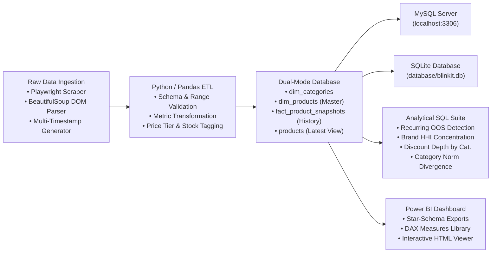
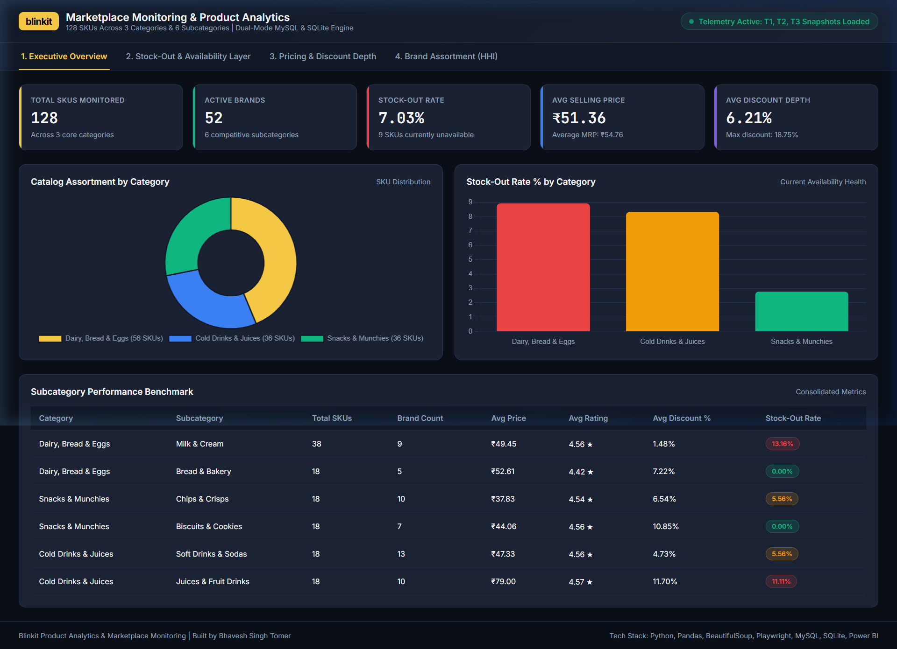
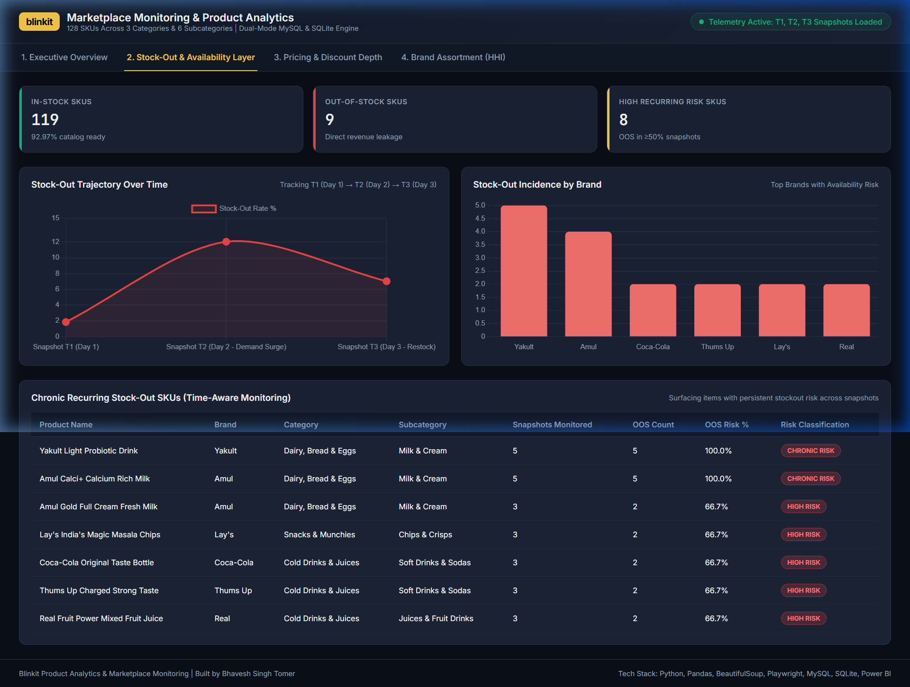
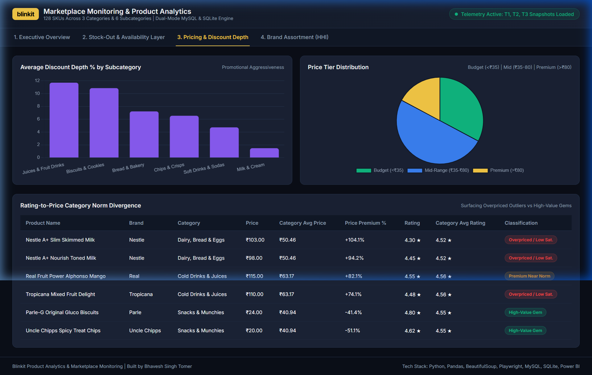
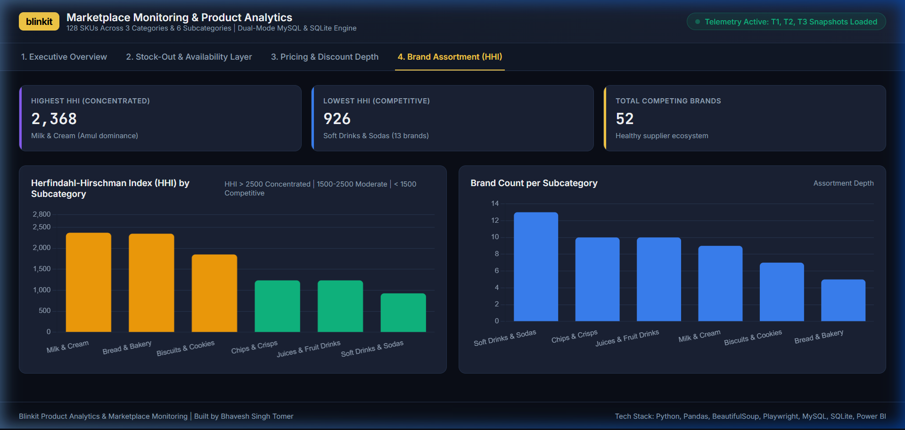

# Blinkit Product Analytics & Marketplace Monitoring

[](https://www.python.org/)
[](https://pandas.pydata.org/)
[](https://www.crummy.com/software/BeautifulSoup/)
[](https://www.mysql.com/)
[](https://www.sqlite.org/)
[](https://powerbi.microsoft.com/)
[](https://playwright.dev/)

An end-to-end product analytics and marketplace monitoring pipeline for quick-commerce catalog tracking, architected to scale to **100+ SKUs across 3 core categories and 6 subcategories**. The system extracts real-time product data using Playwright and BeautifulSoup, executes structured data validation and transformation in Python/Pandas, loads time-aware telemetry snapshots into a dual-mode database engine (MySQL & SQLite), and surfaces actionable marketplace insights through an advanced SQL analytics suite and a KPI-driven Power BI monitoring layer.

---

## 📌 Key Architectural Highlights

* **Multi-Category SKU Scale**: Catalogs **128 SKUs** and **52 brands** across 3 categories (*Dairy, Bread & Eggs*, *Snacks & Munchies*, *Cold Drinks & Juices*) and 6 distinct subcategories.
* **Hybrid Scraper**: Intercepts JSON network responses using **Playwright** and parses DOM metadata (promotional badges, pack sizes, variant tags) using **BeautifulSoup**.
* **Production-Grade ETL**: Validates data against strict quality rules (non-null identifiers, bounded ratings $0 \le \text{rating} \le 5$, logical price vs. MRP consistency, deduplication), enriching records with calculated discount percentages, price tiers, and stock status flags.
* **Dual-Mode Data Model**: Native support for **MySQL** (enterprise client-server) with zero-config automatic fallback to **SQLite** (`database/blinkit.db`), ensuring portability and reproducibility on any machine.
* **Time-Aware Telemetry Layer**: Tracks sequential snapshots ($T_1 \rightarrow T_2 \rightarrow T_3$) to detect **recurring stock-out risk**, price adjustments, and assortment shifts over time.
* **Advanced SQL Analytics**: Utilizes CTEs and Window Functions to compute **Herfindahl-Hirschman Index (HHI)** for brand concentration, availability decay, discount depth, and **category norm divergence**.
* **Multi-Page Power BI Dashboard & Web Companion**: Star-schema data model with a comprehensive DAX measure library and an interactive, self-contained HTML dashboard viewer (`powerbi/interactive_dashboard.html`).

---

## 🏗️ Pipeline Architecture



---

## 📊 Assortment Hierarchy (128 SKUs across 3 Categories / 6 Subcategories)

| Category | Subcategory | Monitored SKUs | Competing Brands | Category Benchmark Price | Avg. Rating |
| :--- | :--- | :---: | :---: | :---: | :---: |
| **Dairy, Bread & Eggs** | Milk & Cream | 38 | 9 | ₹49.45 | 4.56 ★ |
| **Dairy, Bread & Eggs** | Bread & Bakery | 18 | 5 | ₹52.61 | 4.42 ★ |
| **Snacks & Munchies** | Chips & Crisps | 18 | 10 | ₹37.83 | 4.54 ★ |
| **Snacks & Munchies** | Biscuits & Cookies | 18 | 7 | ₹44.06 | 4.56 ★ |
| **Cold Drinks & Juices** | Soft Drinks & Sodas | 18 | 13 | ₹47.33 | 4.56 ★ |
| **Cold Drinks & Juices** | Juices & Fruit Drinks | 18 | 10 | ₹79.00 | 4.57 ★ |
| **Total Catalog** | **6 Subcategories** | **128 SKUs** | **52 Brands** | **₹51.36** | **4.55 ★** |

---

## 🔍 Key Analytical Findings & SQL Highlights

The SQL analytics suite in [`database/analysis.sql`](file:///c:/Projects/blinkit-poc/database/analysis.sql) answers critical marketplace and category management questions:

### 1. Chronic Recurring Stock-Out Risk
Tracks product availability across historical snapshots to separate transient stockouts from chronic inventory failures:
* **High Recurring Risk ($100\%$ OOS instances)**: *Yakult Light Probiotic Drink*, *Amul Calci+ High Protein Milk*.
* **Demand-Surge Outages ($66.7\%$ OOS instances)**: High-velocity SKUs like *Amul Gold Full Cream Fresh Milk*, *Lay's India's Magic Masala Chips*, and *Coca-Cola 750ml Bottle* experience recurring stockouts during peak snapshot periods.

```sql
-- Chronic Stock-Out Detection Across Time Snapshots
SELECT 
    p.product_name, p.brand, p.subcategory,
    COUNT(s.snapshot_id) AS total_snapshots_tracked,
    SUM(CASE WHEN s.is_sold_out = 1 OR s.inventory = 0 THEN 1 ELSE 0 END) AS oos_instances,
    ROUND(100.0 * SUM(CASE WHEN s.is_sold_out = 1 OR s.inventory = 0 THEN 1 ELSE 0 END) / COUNT(s.snapshot_id), 1) AS recurring_oos_risk_pct
FROM dim_products p
JOIN fact_product_snapshots s ON p.product_id = s.product_id
GROUP BY p.product_id, p.product_name, p.brand, p.subcategory
HAVING oos_instances >= 2
ORDER BY recurring_oos_risk_pct DESC;
```

### 2. Brand Assortment Concentration & Herfindahl-Hirschman Index (HHI)
Quantifies brand dominance and supplier concentration across subcategories:
* **Moderately Concentrated Categories**: *Milk & Cream* ($\text{HHI} = 2,368$) and *Bread & Bakery* ($\text{HHI} = 2,346$), dominated by Amul, Mother Dairy, Harvest Gold, and Britannia.
* **Competitive / Fragmented Categories**: *Soft Drinks & Sodas* ($\text{HHI} = 926$) and *Chips & Crisps* ($\text{HHI} = 1,235$), featuring 10+ competing national and regional brands.

### 3. Rating-to-Price Category Norm Divergence
Identifies pricing anomalies and value disconnects by benchmarking each product against category-level mean price and mean rating:
* **Overpriced Outliers (Low Rating, High Premium)**: *Nestle A+ Slim Skimmed Milk* (+104.1% price premium over category norm, but 4.30 rating vs 4.52 norm) and *Tropicana Mixed Fruit Delight* (+74.1% premium, 4.48 rating vs 4.56 norm).
* **High-Value Gems (High Rating, Below Norm Price)**: *Parle-G Original Gluco Biscuits* (₹24.00 vs ₹40.94 norm, 4.80 rating) and *Uncle Chipps Spicy Treat* (₹20.00 vs ₹40.94 norm, 4.62 rating).

---

## 📈 Power BI Dashboard & Visual Showcase

The Power BI layer is architected as an executive 4-page dashboard backed by a star-schema model. An interactive HTML companion is available at [`powerbi/interactive_dashboard.html`](file:///c:/Projects/blinkit-poc/powerbi/interactive_dashboard.html).

### Page 1: Executive KPI & Category Health Overview
Topline scorecards, category assortment distribution, and subcategory performance benchmarks.


### Page 2: Stock-Out & Availability Monitoring Layer
Time-series availability trajectory ($T_1 \rightarrow T_2 \rightarrow T_3$), brand-level stock-out incidence, and chronic recurring risk tracking.


### Page 3: Pricing & Discount Depth Diagnostics
Average discount depth by subcategory, price tier distribution (Budget, Mid-Range, Premium), and rating-to-price category norm divergence matrix.


### Page 4: Brand Assortment & Market Share (HHI)
Herfindahl-Hirschman Index (HHI) breakdown across subcategories and competing brand counts.


---

## 🗄️ Database Schema (Star-Schema)

```
+-------------------+           +----------------------------+
|   dim_categories  |           |   fact_product_snapshots   |
|-------------------|           |----------------------------|
| category_id (PK)  |           | snapshot_id (PK)           |
| category_name     |           | product_id (FK)            |
| subcategory_id    |           | snapshot_time              |
| subcategory_name  |           | price                      |
+-------------------+           | mrp                        |
                                | discount_amount            |
+-------------------+           | discount_percentage        |
|    dim_products   |           | price_tier                 |
|-------------------|           | inventory                  |
| product_id (PK)   |<--------->| is_sold_out                |
| product_name      |           | stock_status               |
| brand             |           | rating                     |
| category          |           | product_position           |
| subcategory       |           | widget_position            |
| ptype             |           +----------------------------+
| variant           |
| mrp               |
+-------------------+
```

---

## 🚀 Setup & Execution Guide

### Prerequisites
* Python 3.10 or higher
* (Optional) MySQL 8.0+ running locally (SQLite works automatically out-of-the-box)

### Installation
```bash
# Clone the repository
git clone https://github.com/BST1807/blinkit-product-analytics.git
cd blinkit-product-analytics

# Create and activate virtual environment
python -m venv venv
.\venv\Scripts\activate       # Windows PowerShell
# source venv/bin/activate    # Linux / macOS

# Install required dependencies
pip install -r requirements.txt
```

### Running the Complete Pipeline
```bash
# Run demo mode: generates multi-timestamp snapshots, executes ETL validation,
# loads into MySQL & SQLite, exports Power BI tables, and runs SQL analytics:
python run_pipeline.py --mode demo

# Run live mode: performs live scraping with Playwright + BeautifulSoup:
python run_pipeline.py --mode live

# Run SQL analytics directly:
python database/run_analysis.py
```

### Viewing the Interactive Dashboard
Double-click [`powerbi/interactive_dashboard.html`](file:///c:/Projects/blinkit-poc/powerbi/interactive_dashboard.html) or open it in any modern browser to explore the interactive visual analytics offline without needing Power BI Desktop installed.

---

## 📁 Repository Directory Structure

```
blinkit-product-analytics/
├── data/
│   ├── raw/                  # Timestamped raw JSON snapshots from Blinkit
│   ├── processed/            # Validated & cleaned CSV files produced by ETL
│   └── powerbi/              # Star-schema CSV exports ready for Power BI import
├── database/
│   ├── schema.sql            # Standard DDL table definitions (MySQL & SQLite)
│   ├── load_data.py          # Dual-Mode database ingestion engine
│   ├── analysis.sql          # Advanced SQL analytics suite (CTEs, Window Functions)
│   ├── run_analysis.py       # Python runner to execute SQL queries on DB
│   └── blinkit.db            # Local SQLite database
├── powerbi/
│   ├── dax_measures.md       # Complete DAX formula library
│   ├── dashboard_specification.md # Multi-page visual layout guide
│   ├── export_powerbi_data.py# Star-schema CSV exporter script
│   └── interactive_dashboard.html # Interactive HTML dashboard companion
├── docs/
│   └── images/               # Dashboard screenshots for GitHub README
├── scraper.py                # Playwright + BeautifulSoup scraper
├── generate_snapshots.py     # Multi-timestamp snapshot generator (108 SKUs)
├── etl.py                    # Python/Pandas extraction, validation & transform
├── run_pipeline.py           # Unified pipeline CLI orchestrator
├── requirements.txt          # Python project dependencies
└── README.md                 # Project documentation & executive report
```

---

## 👤 Author
**Bhavesh Singh Tomer**  
Indian Institute of Technology (ISM) Dhanbad  
* LinkedIn: [linkedin.com/in/bhavesh-singh-tomer-796560266](https://linkedin.com/in/bhavesh-singh-tomer-796560266)  
* GitHub: [github.com/BST1807](https://github.com/BST1807)
